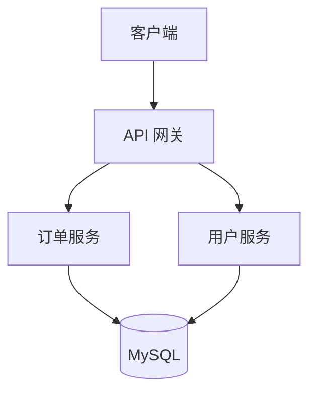
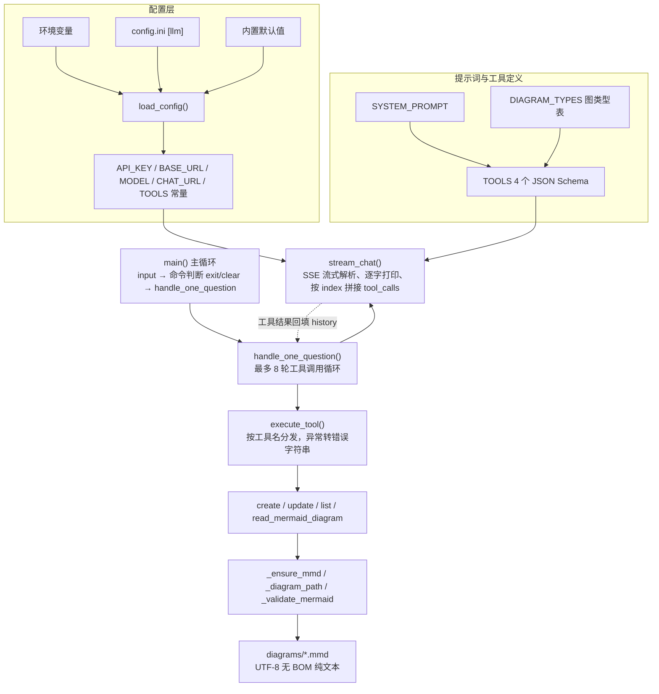

# Practice02 — 流式聊天 + Function Call 实践

基于 OpenAI 兼容接口（默认 DeepSeek）的命令行聊天小程序集，统一支持三大特性：

- **流式输出（Streaming）**：逐字打印模型返回内容；
- **多轮循环（Loop）**：持续对话，`exit` / `quit` / `q` 退出，`clear` 清空历史；
- **会话历史（History）**：本地维护完整消息历史，每次请求都带给模型；
- **Function Call（工具调用）**：模型按需调用本地工具，程序执行后把结果回传，最多 8 轮。

## 文件说明

| 文件 | 说明 |
|------|------|
| `chat-stream-loop-history.py` | 基础版：流式 + 多轮 + 历史，工具 `getDate`（调用本地 `date` 命令获取系统时间） |
| `chat-stream-tool-getDate.py` | 增强版：工具 `getDate` + `isLeapYear`（Python 计算闰年） |
| `chat-stream-tool-isLeapYear.py` | 工具 `isLeapYear` + **10 个本地文件操作工具**（目录/文件的查看、创建、编辑、删除、重命名） |
| `chat-stream-tool-file0ps.py` | **代码架构图创作工具**：用 Mermaid 语法生成架构图，保存为 `.mmd` 纯文本文件 |
| `chat-stream-tool-file0ps-architecture.mmd` | `chat-stream-tool-file0ps.py` 的**代码架构图**（Mermaid 纯文本源码） |
| `config.ini` | LLM 接口配置（`[llm]` 段：`base_url` / `api_key` / `model_name`） |
| `diagrams/` | `chat-stream-tool-file0ps.py` 默认的架构图输出目录（首次保存时自动创建） |

## 运行

```bash
pip install requests
python chat-stream-tool-file0ps.py    # 或其他脚本
```

配置优先级（从高到低）：

1. 环境变量 `OPENAI_API_KEY` / `OPENAI_BASE_URL` / `CHAT_MODEL`
2. 同目录 `config.ini` 的 `[llm]` 段
3. 内置默认值（DeepSeek 官方接口）

---

## chat-stream-tool-file0ps.py — Mermaid 代码架构图创作

把用户描述的系统/模块结构转成 **Mermaid 格式架构图**，落盘为 **`.mmd` 纯文本文件**（UTF-8 无 BOM），可直接被 Mermaid Live Editor、VS Code Mermaid 插件、mkdocs/docusaurus 等渲染。

### Function Call 工具（4 个）

| # | 工具名 | 功能 | 关键参数 |
|---|--------|------|----------|
| 1 | `createMermaidDiagram` | 创作架构图并保存为 `.mmd` 纯文本文件（自动补扩展名、自动建目录、首行关键字校验） | `filename`、`content`、`diagram_type`、`directory`、`overwrite` |
| 2 | `updateMermaidDiagram` | 更新已有 `.mmd` 文件：`overwrite` 整体覆盖 / `append` 追加 / `replace` 唯一片段替换 | `filename`、`mode`、`content`、`old_str`、`new_str` |
| 3 | `listMermaidDiagrams` | 列出目录下所有 `.mmd` 架构图文件（名称与大小） | `directory`（默认 `diagrams/`） |
| 4 | `readMermaidDiagram` | 读取某个 `.mmd` 文件的 Mermaid 源码 | `filename` |

支持的图类型（`createMermaidDiagram` 会校验源码首行关键字）：
`flowchart` / `graph`（流程图、代码架构图）、`sequenceDiagram`（时序图）、`classDiagram`（类图）、`stateDiagram-v2`（状态图）、`erDiagram`（ER 图）、`gantt`（甘特图）、`pie`（饼图）、`mindmap`（思维导图）、`timeline`（时间线）。

### 使用示例

```
你> 帮我画一个微服务系统架构图，包含客户端、网关、订单服务、用户服务和 MySQL
[调用工具] createMermaidDiagram({'filename': 'microservice-arch', 'diagram_type': 'flowchart', ...})
[工具结果] 架构图已保存: .../diagrams/microservice-arch.mmd（Mermaid 纯文本，8 行，... 字节）
```

生成的 `diagrams/microservice-arch.mmd` 内容形如：



### 代码架构图

本脚本自身的结构图见 [`chat-stream-tool-file0ps-architecture.mmd`](./chat-stream-tool-file0ps-architecture.mmd)（Mermaid 纯文本，可用 Mermaid Live Editor / VS Code Mermaid 插件直接渲染）。整体分为 7 层：



各层职责：

| 层 | 关键函数 / 常量 | 职责 |
|----|-----------------|------|
| 配置层 | `load_config()`、`DEFAULT_CONFIG` | 环境变量 → `config.ini` → 默认值 三级合并 |
| 提示词与工具定义 | `SYSTEM_PROMPT`、`DIAGRAM_TYPES`、`TOOLS` | 约束模型用 Mermaid 作图并落盘；4 个工具的 JSON Schema |
| 主循环 | `main()` | 输入读取、`exit`/`clear` 命令、网络与接口异常兜底 |
| 单次问答 | `handle_one_question()`、`build_assistant_message()` | 组装历史 → 请求 → 执行工具 → 结果回填，`MAX_TOOL_ROUNDS = 8` 防死循环 |
| 流式请求 | `stream_chat()` | SSE 逐行解析，文本增量实时打印，`tool_calls` 按 `index` 拼接 |
| 工具分发与实现 | `execute_tool()`、4 个 `*_mermaid_diagram()` | 参数解析、路径解析、源码校验、读写 `.mmd` |
| 文件辅助与落盘 | `_ensure_mmd()`、`_diagram_path()`、`_validate_mermaid()` | 补扩展名、路径归一到 `diagrams/`、首行图类型关键字校验 |

---

## chat-stream-tool-isLeapYear.py — 本地文件操作 + 闰年判断

### Function Call 工具（11 个）

| # | 工具名 | 功能 |
|---|--------|------|
| - | `isLeapYear` | 判断指定年份是否为闰年（能被 4 整除但不能被 100 整除，或能被 400 整除） |
| 1 | `getCwd` | 获取当前工作目录 |
| 2 | `listDirectory` | 列出指定目录下所有文件和子目录（含类型、大小） |
| 3 | `getFileType` | 获取指定文件的文件类型（扩展名、MIME、大小、纯文本/二进制） |
| 4 | `readFile` | 获取文件内容，**仅支持纯文本格式**（二进制会被拒绝，默认截断 4000 字符） |
| 5 | `createFile` | 根据指定的目录和文件名创建文件（可选初始内容、`overwrite`） |
| 6 | `editFile` | 编辑文件内容，**仅支持纯文本格式**：`overwrite` / `append` / `replace` |
| 7 | `createDirectory` | 创建新目录（含多级，已存在不报错） |
| 8 | `deleteDirectory` | 删除目录（**支持非空**，递归删除，不可恢复） |
| 9 | `deleteFile` | 删除文件 |
| 10 | `renamePath` | 重命名（或移动）文件和目录 |

安全设计：路径统一解析为绝对路径；`filename` 禁止携带路径分隔符；读/写前做纯文本判定（扩展名白名单 + NUL 字节 + UTF-8/GBK/UTF-16 编码嗅探）；`replace` 要求片段唯一，避免误改；删除、覆盖等破坏性操作由 system prompt 要求先向用户确认。

## chat-stream-tool-getDate.py / chat-stream-loop-history.py — 时间与闰年

| 工具名 | 功能 |
|--------|------|
| `getDate` | 调用本地操作系统 `date` 命令（Windows 为 `date /t` + `time /t`）获取真实日期时间，可选 `format` = `full` / `date` / `time` |
| `isLeapYear` | 用 Python 代码计算闰年（`calendar.isleap` 交叉验证），仅 `getDate` 版包含 |

## 通用实现要点

- SSE 流式响应强制按 UTF-8 解码（避免 requests 默认 ISO-8859-1 造成的中文乱码）；
- 流式阶段按 `tool_calls[].index` 拼接增量参数，`finish_reason` 到达后统一执行；
- 单次提问最多 `MAX_TOOL_ROUNDS = 8` 轮工具调用，防止死循环；
- 工具异常统一转换为可读错误字符串回传给模型，由模型继续解释或重试。
